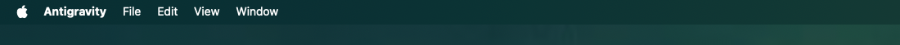

# TallBar

**TallBar** is a lightweight, zero-configuration macOS menu bar utility that brings the tall, spacious MacBook Liquid Retina menu bar (~50 pt) to **any external monitor**.

Standard external monitors on macOS have a narrow menu bar (~24–31 pt). **TallBar** dynamically unlocks the native MacBook safe area padding and tall menu bar height on any display, without changing your screen resolution or requiring complex HiDPI preset switching.

---

## 📸 Before & After

### Before (Standard macOS Menu Bar — 31 pt)


### After (TallBar Active — 50 pt Spacious Height)


---

## ✨ Features

* **Universal Display Support**: Dynamically adapts to any monitor resolution and aspect ratio — including 32:9 Super Ultrawide (5120×1440, 7680×2160), 21:9 Ultrawide (3440×1440), 16:9/16:10 4K, 5K, QHD, FHD, or portable displays.
* **Exact 1:1 Desktop Space**: Preserves your existing desktop scale and window layout. Your windows, icons, and text sizes stay exactly as they were.
* **Crystal-Clear 2x Retina Backing Store**: Generates a 2x Retina backing buffer to ensure razor-sharp text and crisp icon rendering with zero blurriness.
* **Native Refresh Rate Matching**: Automatically locks onto your monitor's native refresh rate (60 Hz, 120 Hz, 144 Hz, 240 Hz) to eliminate flicker and stutter.
* **Accurate Color (EDID Chromaticities)**: Reads your monitor's hardware EDID color primaries (sRGB, Display P3) via IOKit for zero ColorSync conversion overhead.
* **Preserves Multi-Monitor Layouts**: Secondary and side monitors stay in their exact relative positions.
* **Native Notch App Compatibility**: Exposes hardware `safeAreaInsets` (top: 48.5 pt) and auxiliary top zones, allowing notch apps (Vorssaint, Boring Notch, Dynamic Lake, etc.) to work out-of-the-box.
* **Minimalist Status Bar Menu**: Simply click the icon in your menu bar to toggle on/off or quit.

---

## 🚀 Installation & Usage

### Prebuilt Binary
1. Download **[TallBar-v1.0.0.zip](releases/TallBar-v1.0.0.zip)** from the `releases/` folder.
2. Unzip and drag `TallBar.app` to your `/Applications` folder.
3. Launch `TallBar`. The tall menu bar activates immediately.

### Menu Bar Controls
* Click the menu bar icon to toggle between **Tall Menu Bar** and **Standard Menu Bar**.
* The menu displays your monitor's active resolution and refresh rate (e.g., `5120x1440 @ 120Hz`).
* Quitting the app seamlessly restores your normal display arrangement.

---

## 🛠 Building from Source

Requirements: macOS 12.0+ (Apple Silicon), Xcode Command Line Tools.

```bash
git clone https://github.com/vsemkin/TallBar.git
cd TallBar
./build.sh
open build/TallBar.app
```

---

## 📄 License

MIT License.
